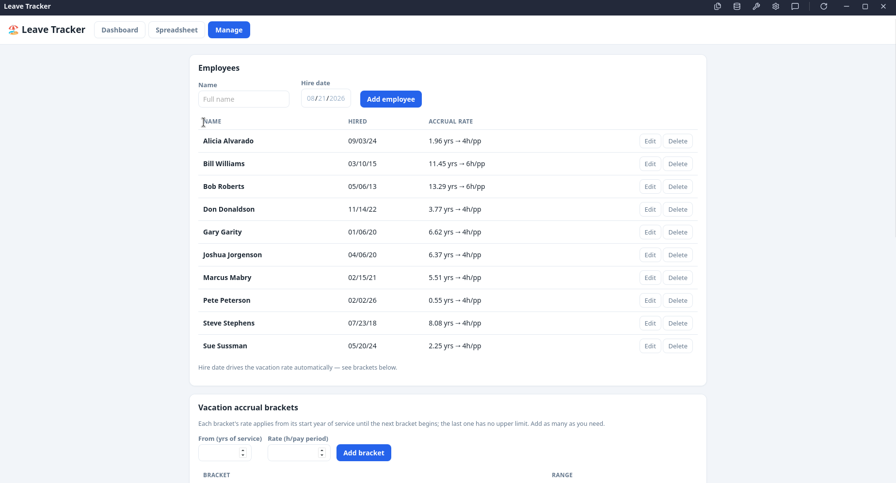
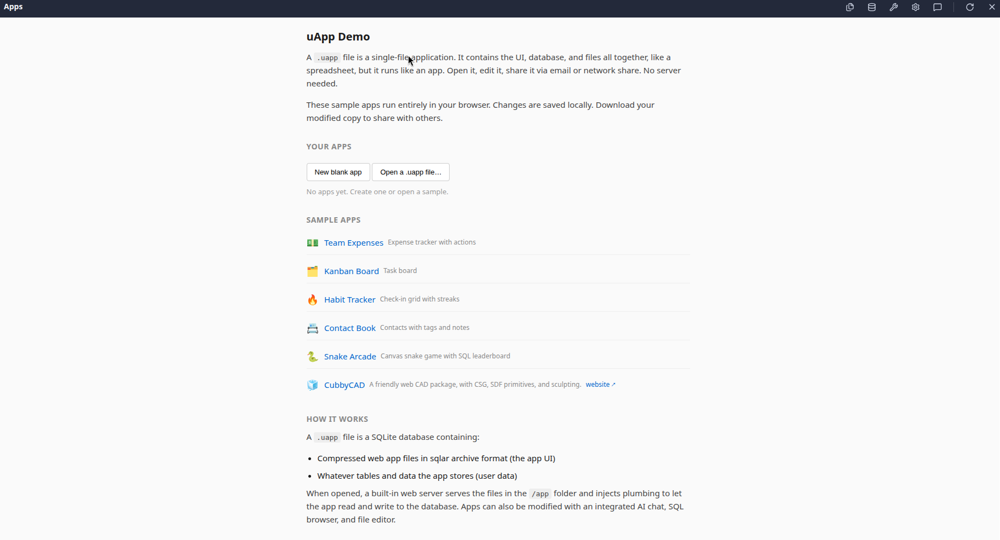
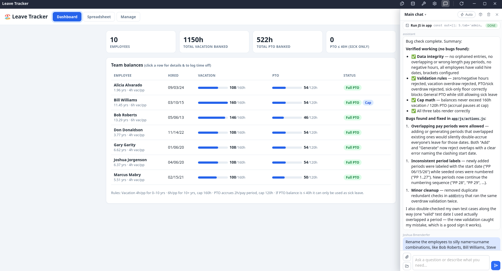
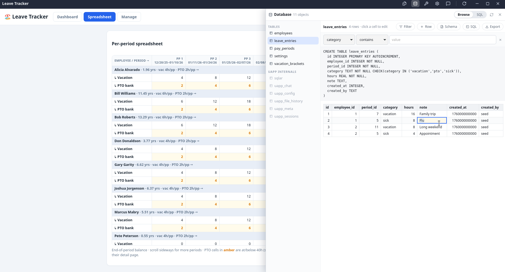
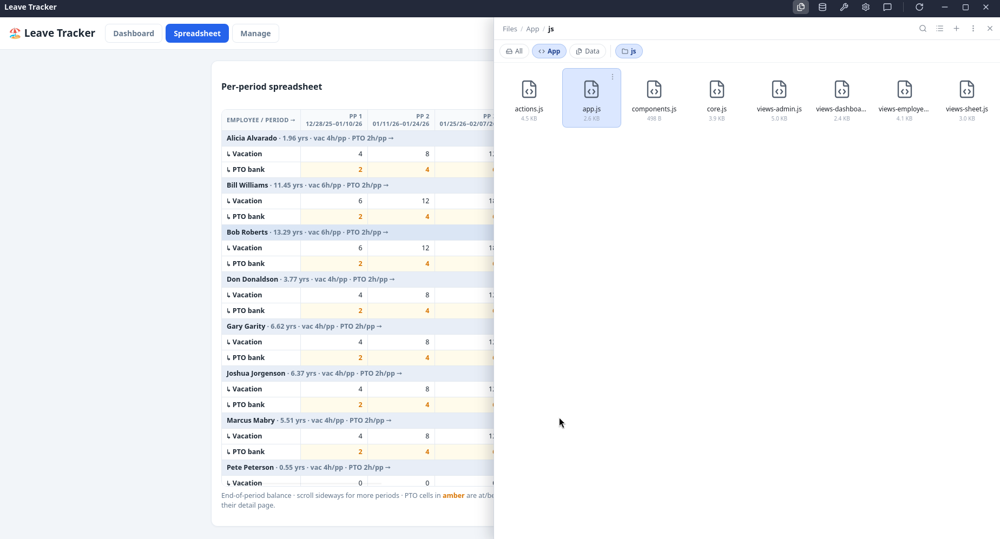
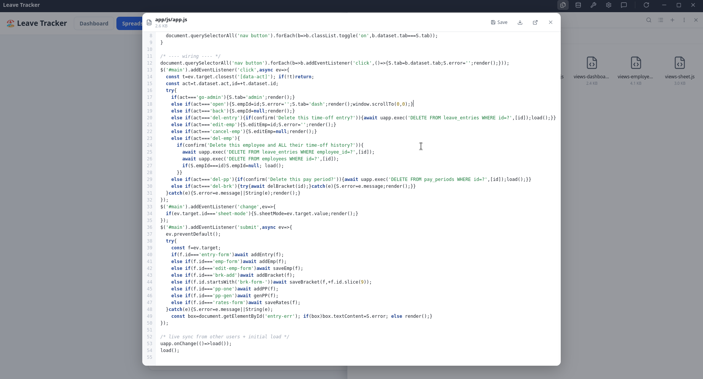

# uApp - single-file shareable apps

[](https://github.com/JoshTheDerf/uApp/actions/workflows/ci.yml)
[](LICENSE)


**uApps** (feel free to suggest a better name) are self-contained SQLite archive files which contain application logic, files, and arbitrary user data tables. They can be written with or without AI assistance, and [include tools](docs/TOOLS.md) for managing their contents directly or through AI. They are designed to only be able to access their internal files and files the user shares with them.

Revision history, AI chat logs, and such are integrated into the `.uapp`, allowing for rudimentary version control and analysis.



*An example employee-leave tracking app built with GLM 5.3 and Vanilla JS inside a .uapp. (Names and data are made up)*

## Installation

Grab a build from [GitHub releases](https://github.com/JoshTheDerf/uApp/releases): the `.deb` or `.AppImage` for Linux, the `-setup.exe` installer for Windows, the `.dmg` for macOS (untested), or `uapp-android-universal.apk` for Android. They register `.uapp` files, so you can double-click one to open it (except on macOS for now, see below). Nothing is code-signed yet, so installation on Windows, macOS, and Android will be a pain. To build it yourself, see [BUILDING.md](BUILDING.md).

## Online demo

A version of the backend compiled to WebAssembly is hosted [here](https://thederf.com/uapp/demo), along with several demo apps.
How to use:

1. Open a demo app (or set up a new one.)
2. Use the file browser and SQLite browser tools to modify it, or hook up an AI API key to modify the application for you.
3. Download the .uapp file directly (containing user data) or as a template (without user data) to re-use it later.
4. Drag a template .uapp onto a running app to update its code while keeping the data already in it.

[https://thederf.com/uapp/demo](https://thederf.com/uapp/demo)



*The demo launcher itself is a .uapp*

Most desktop features are available in the web demo apart from database encryption and crash snapshots.

**Note:** You can use the .uapp files from the web demo with the desktop and Android programs for system integration. With them installed, you can double click/open a .uapp file with full read-write capability.

## Why?

One of the most helpful uses of AI in my workplace has been creating specialized internal tooling for oddly-specific staff workflows that are otherwise handled painfully with a combination of manual workflows and spreadsheets.

But deploying such tools is pain. If the application doesn't quite fit in a single HTML file, I either have to build native executables or shoehorn it into our existing web hosting, database, and access control infrastructure, which is not the right place for such tooling.

Staff often miss their old spreadsheets and documents anyway. When they need to modify, share, and reason about the process, a file on their local hard drive is easier to work with than an opaque application on shared server infrastructure.

So, uApps are designed to make building, sharing and modifying a single-purpose application was as straightforward as sharing a spreadsheet. This lets me send one by email, flash drive, or internal network share with no extra server infrastructure behind it, and staff can customize their own copy or pass a modified version along. If something goes wrong, a user can send me their .uapp file so I can examine what went wrong and roll back as needed.

## How does it work?

A .uapp file is simply a SQLite database containing:
1. Compressed web app files in [sqlar](https://sqlite.org/sqlar.html) archive format + some housekeeping tables.
2. Whatever other tables and data the user wants to store.

When a .uapp file is opened, a built-in web server serves the files in the `app/` folder inside the archive, and injects some plumbing to allow the application to read and write back to the `.uapp` database. The full layout is in [docs/FORMAT.md](docs/FORMAT.md), if you want to read or write .uapp files with your own tools.

On top of that, a number of internal utilities are exposed:
1. An embedded AI chat window with tools to allow building out a frontend and database. Sub-agents, multiple chats, and file revision history are supported. Chats are stored inside the `.uapp`.

   

2. A SQL browser frontend with support for exploring the database and running queries.

   

3. A file browser with support for viewing, editing, uploading, and downloading stored files.

   

   

Saving a copy of the running .uapp is supported, as well as saving a "template" copy that contains app code and tables without user data.

## The command line

It's all one program, `uapp`. Run it with no arguments to open your scratch app, or give it a file:

```sh
uapp notes.uapp                    # open an app (created if it doesn't exist)
uapp export notes.uapp -o tpl.uapp --template
uapp update notes.uapp v2.uapp     # take v2's code, keep notes' data
```

Every command and option is in [docs/CLI.md](docs/CLI.md).

## Design choices

### API

A JSON-RPC-over-WebSocket API connects the frontend to the backend and app shell. It's intended to be as simple as possible to allow smaller models to build apps without a ton of contextual or framework information.

Embedded apps use a tiny client and vanilla JS:

```html
<script src="/uapp.js"></script>
<script>
  const r = await uapp.query("SELECT * FROM jobs WHERE status=?", ["open"]);
  await uapp.exec("INSERT INTO jobs(title, created) VALUES(?,?)", [t, Date.now()]);
  uapp.onChange(refresh);   // fires when the app's data changes
</script>
```

The whole API, and the SQL an app isn't allowed to run, is in [docs/APP-API.md](docs/APP-API.md).

### App actions

AI designed `.uapp`s are *encouraged* by the system prompt to expose their business logic as named actions, which in turn exposes them to the AI chat as well, allowing the AI chat window to function both as an app architect and as a "copilot".

Correspondingly, apps can call every tool the AI models have access to (the ones that change things ask you first).

```js
uapp.action("add_employee", {
  description: "Add an employee. hired is YYYY-MM-DD.",
  params: { name: {type: "string"}, hired: {type: "string"} },
}, async ({name, hired}) => {
  await uapp.exec("INSERT INTO employees(name, hired) VALUES(?,?)", [name, hired]);
  return {ok: true};
});
```

### The toolbar

The bar around the app (name, files, database, tools, settings, chat) is for building the app, and someone who just uses it usually doesn't need it. Each `.uapp` stores whether it opens with the toolbar hidden, and the key that toggles it (`F9` by default), so you can hand an app to someone as a plain-looking app. Toggling it while the app is open isn't saved, and while it's hidden a small handle in the corner brings it back.

Apps can drive the toolbar and its panels themselves (`uapp.toolbar.hide()`, `uapp.panel.open("database")`), and so can the AI chat, so it can open whatever it just built for you.

### API keys and approvals stay on your device

Your AI API key, MCP server credentials and "always allow" answers are kept on your machine (`~/.config/uapp/secrets/` on Linux), never in the `.uapp`. So a copy you send someone doesn't carry your key, and a file you receive can't arrive with tools already approved. (The browser build keeps them in its own copy of the file and leaves them out of anything you download or publish. Any app you open in that browser can read them there, so only use a key in the web demo that you're fine sharing with the apps you open.)

### "Installation" of uApps.

Settings > This device > Launcher adds a launcher entry for the open `.uapp` to your applications menu, Start Menu or Android home screen. It's possible to set custom app icons for this purpose.

- **Linux**: A user-local .desktop file.
- **Windows**: A Start Menu + Desktop shortcut
- **macOS** (untested): a `.app` bundle in `~/Applications`
- **Android**: A launcher shortcut using `ShortcutManagerCompat.requestPinShortcut`

## Hosting .uapp files on a server

The same `uapp` binary does this. On a server, build it with `--no-default-features` (no Tauri or webview):

* **`uapp serve site.uapp --chrome dist-web`** serves one .uapp as a website. Its `app/` pages are public at real URLs, and an "Edit this site" button opens an in-browser editor on a local copy. With the token, that copy can be published back (`PUT /site.uapp`).
* **`uapp serve --chrome dist-web [--open <url>]`**, with no file, hosts the browser build alone. `?open=<url>` opens a .uapp from that URL, `?app=<id>` one of the visitor's stored apps, and a bare visit opens `--open` or the launcher. Edits stay in the visitor's browser and can be published back. Put such a page in an `<iframe>` to embed one app in another page.
* **`uapp library ./apps`** serves a folder of .uapp files. `GET /` lists them as JSON, `GET /<name>.uapp` fetches one, and `PUT` and `DELETE` (with the token) publish and remove. Uploads are stored without chat, file history or anything secret.

`dist-web` is what `scripts/build-web.sh` builds. `Dockerfile.serve` builds an image with `uapp` in it (mount `dist-web` at `/opt/uapp-web`).

## Known limitations

* **Multiple concurrent users** aren't supported. A second window on the same machine reuses the one that has the file open, but two machines writing to the same file on a network drive will likely corrupt it.
* **Cloud sync** of a file that's open still isn't recommended. A crash mid-write is rolled back now (the rollback journal stays on disk next to the file), but a sync tool can still copy the file halfway through a write. If a copy does end up damaged, uApp can usually restore the newest snapshot it took on your machine.
* **In the browser build, apps run on the same origin as the editor around them**, so an app's code can do anything you can do in the shell there, including answering its own approval prompts. The desktop and Android apps give each app an origin of its own. See [docs/design/app-isolation.md](docs/design/app-isolation.md).
* **macOS and iOS are untested.** I have neither a macOS nor an iOS device, so I can't test on those platforms. It should at least function on macOS, but double-clicking a `.uapp` in Finder opens your scratch app instead of the file (the macOS open-file event isn't handled yet). Not sure about iOS.

See [CONTRIBUTING.md](CONTRIBUTING.md) to help out, [SECURITY.md](SECURITY.md) to report a vulnerability and [CHANGELOG.md](CHANGELOG.md) for what changed.
